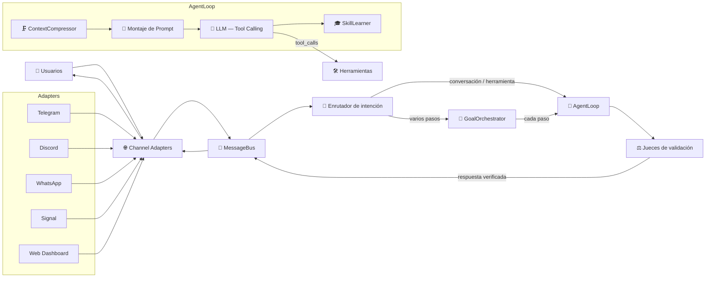

# NewClaw 🪐

> **Idiomas:**
> 🇺🇸 [English](README.md) | 🇧🇷 [Português](README.pt-br.md) | 🇪🇸 **Español**

[](https://opensource.org/licenses/MIT)
[](https://nodejs.org/)
[](https://github.com/rovanni/NewClaw)
[](https://github.com/rovanni/NewClaw/pulls)


> **Seguridad:** [Política de Seguridad](SECURITY.es.md) — cómo reportar una vulnerabilidad en privado.
>
> **Documentación técnica:** [Visión Técnica](docs/TECHNICAL_OVERVIEW.es.md) — arquitectura, el
> motor de ejecución orientado a objetivos (Goals), la barrera de groundedness, los internals de
> la memoria, y cómo funciona por dentro el enrutamiento de modelos (incluyendo soporte para
> `.gguf`/llamafile 100% offline).

---

> **Tú:** "Mi hija adora las matemáticas."
>
> *Dos días después:*
>
> **Tú:** "¿Qué sabes sobre mi familia?"
> **NewClaw:** "Tu hija adora las matemáticas."
>
> *Sin fine-tuning. Sin contexto inyectado manualmente. Sin repetirte.*

---

## El asistente de IA que realmente te recuerda

Hoy, todos los asistentes de IA olvidan todo en cuanto termina la sesión. Te repites constantemente. El contexto que construiste la semana pasada desapareció. El agente nunca aprende quién eres de verdad.

**NewClaw es diferente.**

Se ejecuta localmente en tu máquina, construye una memoria persistente sobre quién eres, y permanece contigo en Telegram, WhatsApp y Discord — incluso después de semanas o meses. El mismo agente. La misma memoria. Siempre.

---

## Vélo en acción

### Memoria que persiste a lo largo del tiempo

```
Tú: "Estoy trabajando en un proyecto llamado Orion — es un sistema de gestión de clientes."
NewClaw: "Entendido. Agregué Orion a tus proyectos conocidos."

[Una semana después]

Tú: "¿En qué proyectos estoy trabajando?"
NewClaw: "Tienes Orion — un sistema de gestión de clientes que mencionaste la semana pasada."
```

### Contexto que moldea las respuestas futuras

```
Tú: "Odio las reuniones antes de las 10 de la mañana."

[Unos días después]

Tú: "Agenda una reunión con el equipo para mañana."
NewClaw: "Voy a sugerir horarios después de las 10, ya que lo prefieres así."
```

### El mismo agente en todos lados

Envías un audio por Telegram en la mañana. Luego abres el dashboard web. Por la noche respondes desde Discord. Es el mismo NewClaw — con la misma memoria y el mismo contexto — en todos los canales.

---


*Grafo de memoria real — 65 nodos, 167 aristas. Etiquetas eliminadas por privacidad.*

---

## Instalación Rápida

**Linux/macOS:**
```bash
curl -fsSL https://raw.githubusercontent.com/rovanni/NewClaw/main/install.sh | bash
```

**Windows (PowerShell como Administrador):**
```powershell
& ([scriptblock]::Create((irm https://raw.githubusercontent.com/rovanni/NewClaw/main/install.ps1).TrimStart([char]0xFEFF)))
```

### Requisitos

- Windows 10 (1809+) / Windows 11, o Linux/macOS
- Node.js 22.22.2+ o 24.15.0+ (el instalador lo instala automáticamente si falta)
- npm (cualquier versión reciente; con npm 12.2+ también se aplica la lista de scripts de instalación permitidos del proyecto)
- El adaptador local de Cognitive Kernel es opcional; para desarrollo con el repositorio hermano y sus dependencias instalados, vincúlalo con `node scripts/link-local-kernel-adapter.cjs`
- 2GB+ de RAM, 5GB+ de espacio libre en disco
- No se necesita ningún canal de chat para empezar — NewClaw funciona de forma
  independiente a través del Dashboard Web local (`http://localhost:3090`). Agrega
  Telegram, Discord, WhatsApp o Signal más adelante con `newclaw channels enable <canal>`.

### Solución de problemas de instalación

- **Windows — "no se puede cargar porque la ejecución de scripts está deshabilitada en este
  sistema"**: esto solo ocurre si descargaste el archivo y ejecutaste `.\install.ps1`
  directamente, en vez del comando `irm | iex` de arriba (que no sufre esta restricción).
  Solucionalo una vez con:
  ```powershell
  Set-ExecutionPolicy RemoteSigned -Scope CurrentUser
  ```
  Esto afecta solo tu cuenta de usuario, no toda la máquina, y también evita el mismo
  bloqueo en comandos `npm` más adelante. El instalador ya verifica y corrige esto
  automáticamente cuando logra ejecutarse.
- **Windows — PM2 no conecta / el bot no se mantiene activo**: normalmente es un daemon de
  PM2 iniciado con otro nivel de privilegios, dejado atrás (error `EPERM` en el named pipe).
  Ejecuta `newclaw doctor` para un diagnóstico completo, o usa `npm start` como alternativa
  (sin auto-restart, pero funciona).
- **`newclaw update` falla al compilar (error de TypeScript sobre un módulo faltante)**: el
  `npm ci` se ejecuta automáticamente en cada update, así que esto debería ser raro —
  pero si pasa (ej: red inestable durante la instalación, o una dependencia nativa que falló
  al compilar), solucionalo a mano:
  ```bash
  cd <tu carpeta de instalación de NewClaw>
  npm ci
  npm run build
  newclaw restart --daemon
  ```
- **En cualquier momento**: ejecuta `newclaw doctor` para revisar Node, PM2, Ollama, canales
  configurados, espacio en disco y el auto-inicio en Windows, todo de una vez.

---

## Cómo se compara NewClaw

| Otros asistentes | NewClaw |
|---|---|
| Olvida todo al terminar la sesión | Memoria persistente — recuerda por días, semanas, meses |
| Tus datos viven en servidores de terceros | Local-first — con un modelo local nada sale de tu máquina; con un modelo en la nube, las solicitudes van solo al proveedor que elegiste |
| Una interfaz (generalmente solo un chat) | Telegram, WhatsApp, Discord, Signal, Web — un solo agente |
| Empieza de cero en cada conversación | Construye un modelo de mundo sobre ti que evoluciona con el tiempo |
| Requiere suscripciones costosas a APIs | Funciona con el modelo que elijas — local (Ollama, `.gguf`) o en la nube — y nunca lo cambia por otro sin que lo sepas |

---

## Qué puedes hacer con él

- **Preguntar cualquier cosa sobre tu historial** — preferencias, decisiones, proyectos, personas que mencionaste
- **Usar cualquier canal** — Telegram, WhatsApp, Discord, dashboard web, o todos a la vez
- **Mantener tus datos privados** — con un modelo local, todo queda en tu máquina; nube solo si la eliges
- **Dejar que aprenda tus patrones** — crea atajos (skills) basados en cómo trabajas realmente, y te avisa cuando lo hace
- **Ejecutarlo en tu servidor** — servicio persistente en segundo plano, soporte SSH, multi-instancia

---

## Funcionalidades

| Feature | Lo que hace por ti |
|---|---|
| 🧠 **Memoria Semántica** | Recuerda personas, preferencias, proyectos, hechos — y las conexiones entre ellos |
| 🔀 **Multi-Canal** | Telegram, Discord, WhatsApp, Signal, Web — un agente en todos los canales |
| 🛡️ **Local-First** | Sin nube obligatoria. Sin recolección de datos. Se ejecuta en tu hardware |
| 🎓 **Aprendizaje de Skills** | Observa cómo trabajas y crea atajos reutilizables; avisa de cada skill nueva (`/skills` las lista, `/skill_desativar` desactiva una) |
| 🎯 **Solo el modelo que elegiste** | Ollama (local o nube), `.gguf`/llamafile, Gemini, DeepSeek, Groq, OpenRouter, Anthropic o cualquier endpoint compatible con OpenAI. Sin cambio automático: si el elegido falla, NewClaw dice lo que respondió |
| 🎯 **Objetivos verificados** | Las solicitudes de varios pasos se convierten en un objetivo planificado; lo que la respuesta afirma como dato de herramienta se verifica contra lo que las herramientas realmente devolvieron |
| 🔐 **Bóveda de contraseñas** | Una contraseña enviada con etiqueta (`contraseña: …`) o con `/segredo <nombre> <valor>` sale del mensaje y va a la bóveda — no llega a registros, historial ni a los modelos (`/segredos` lista, `/segredo_apagar` elimina) |
| 💾 **Copia del conocimiento** | Guarda lo que NewClaw aprendió en un `.zip`, lo restaura o lo combina con otra instalación (`newclaw backup`, `restore`, `import`) |
| 📊 **Dashboard Web** | Grafo de memoria visual, chat en tiempo real, configuración completa |
| 🌐 **Búsqueda Web** | Investiga temas y sintetiza respuestas desde múltiples fuentes |
| 🖥️ **SSH Exec** | Ejecuta comandos en servidores remotos directamente desde el chat |
| 📸 **Snapshots de Memoria** | Versiona el conocimiento del agente — crea, restaura y compara estados |
| 🛡️ **Auto-Auditoría** | El agente inspecciona y corrige su propio runtime con `/audit` |

---


*Dashboard Web — visualización interactiva del grafo con tipos de nodo: Identidad, Preferencia, Proyecto, Contexto, Hecho, Habilidad.*

---

## Comandos CLI

| Comando | Descripción |
|---|---|
| `newclaw start` | Inicia el agente (`--daemon` lo ejecuta en segundo plano, ideal para un VPS) |
| `newclaw stop` / `newclaw restart` | Termina / reinicia el servicio |
| `newclaw status` | Health check, PID, tiempo activo y configuración |
| `newclaw logs -f` | Registros en tiempo real |
| `newclaw doctor` | Diagnóstico completo: Node, PM2, Ollama, canales, disco |
| `newclaw repair` | Corrige el inicio automático en Windows (Tarea Programada) |
| `newclaw update` | Actualiza el código desde GitHub y recompila (`update restart` también reinicia; `update channel` elige Stable/Preview/Development) |
| `newclaw passwd` | Define o cambia la contraseña del Dashboard |
| `newclaw onboard` | Configura proveedores y claves de API |
| `newclaw lang` | Muestra el idioma configurado (se cambia en el Dashboard) |
| `newclaw channels` | Estado de los canales (Telegram, Discord, WhatsApp, Signal) |
| `newclaw channels enable <nombre>` / `disable <nombre>` | Activa / desactiva un canal |
| `newclaw backup` | Guarda lo que NewClaw aprendió en un `.zip` (opciones: `--historico`, `--workspace`, `--segredos`) |
| `newclaw restore [archivo.zip]` | Restaura el conocimiento de una copia (sin archivo, abre el asistente) |
| `newclaw import <archivo.zip>` | Combina el conocimiento de otra instalación, sin borrar nada |
| `newclaw uninstall` | Elimina NewClaw y limpia el sistema |
| `newclaw help` | Lista todos los comandos |

---

## Auditor de Auto-Diagnóstico

NewClaw puede inspeccionar su propio código y comportamiento en tiempo de ejecución usando el LLM local.

> **Solo para el propietario.** Funciona en cualquier canal (Telegram, Discord, etc.).

| Comando | Descripción | Tiempo |
|---|---|---|
| `/audit` | Auditoría completa — código, runtime, datos, integraciones | ~1-3 min |
| `/audit fix` | Auto-corrección — aplica solo correcciones de bajo riesgo validadas | ~1-5 min |
| `/cancel` | Cancela la operación en curso (`/cancelar`, `/stop`, `/pare` también funcionan) | instantáneo |

---

<details>
<summary>⚙️ Cómo funciona internamente</summary>

### Flujo de Mensajes



Para la filosofía arquitectónica completa detrás de esto (por qué los canales nunca tocan lógica
de IA, qué está prohibido importar dónde, cómo agregar un canal nuevo), ver
[docs/ARCHITECTURE.md](docs/ARCHITECTURE.md).

### Sistema de Sesiones (v2)

| Componente | Propósito |
|---|---|
| **SessionTranscript** | Log JSONL append-only, cada evento grabado con número de secuencia y metadatos |
| **SessionManager** | Mutex por sesión, compresión híbrida (10 msgs o 2500 tokens) |
| **SessionContext** | Construye el contexto LLM: prompt → checkpoint → mensajes recientes → memoria semántica |
| **SessionLearner** | Extrae hechos de las conversaciones para el grafo cognitivo |

### Modos de Operación

Un enrutador de intención (LLM) decide, en cada mensaje, cómo se atiende:

1. 💬 **Directo** — conversación natural usando el contexto de largo plazo, sin herramientas
2. 🛠️ **Herramienta** — una acción puntual (búsqueda web, memoria, comando, archivo)
3. 🗺️ **Planificado** — varias herramientas en secuencia dentro de la misma respuesta
4. 🎯 **Objetivo** — tarea de varios pasos: el `GoalOrchestrator` planifica, ejecuta, verifica cada paso y replanifica cuando algo falla

</details>

---

## Roadmap

El roadmap detallado está en [docs/ROADMAP.md](docs/ROADMAP.md).

## Licencia

MIT — [opensource.org/licenses/MIT](https://opensource.org/licenses/MIT)

---

*NewClaw — La IA que realmente te recuerda.* 🪐
